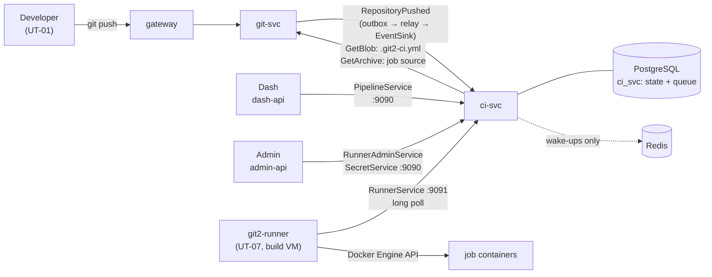
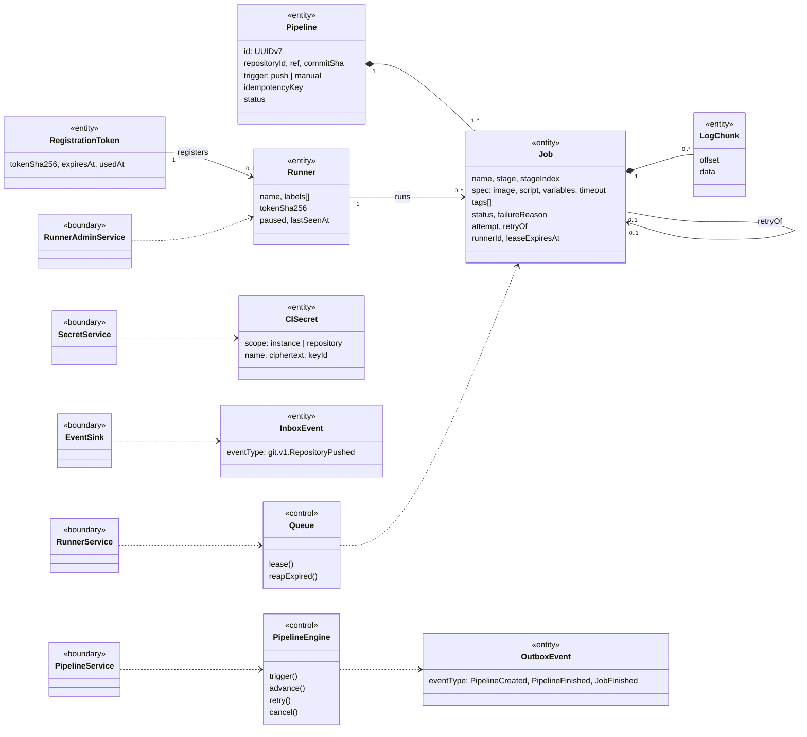
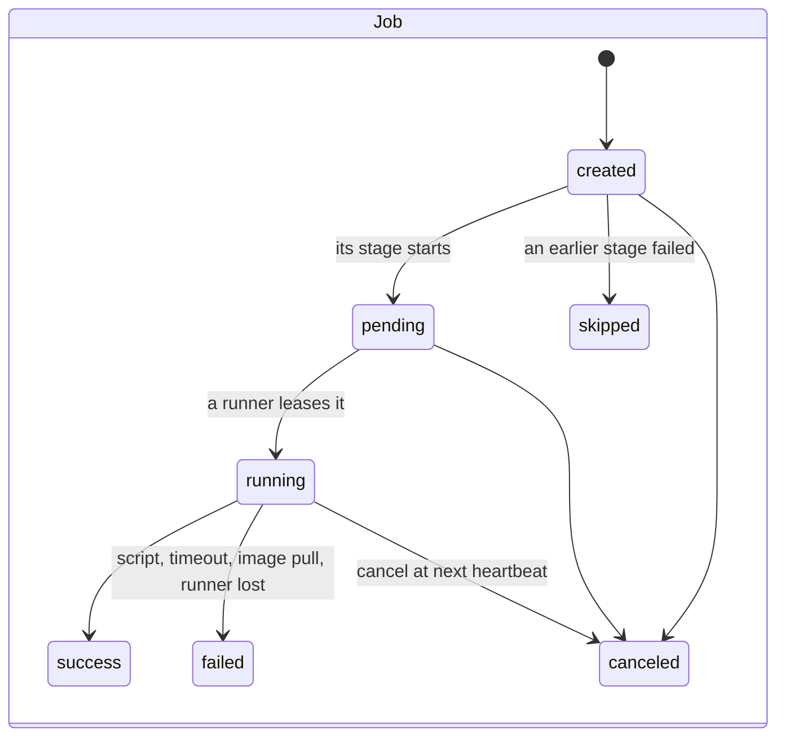

# Requirement Analysis Report: CI/CD section (WBS-18.5)

**For:** Beste (editor of the Requirement Analysis Report, due Mon 23 Nov 2026). **From:** Osman, Pipelines lane. **Issue:** git2-runner #36, with the queue wording of #27.
**Analyses:** the CI part of the Requirements Specification v1.1: T-10 (FR-50–FR-63), the runner part of T-11 (FR-66, FR-67), NFR-06, -07, -13, -14, -21, -26 and UC-21–UC-23.
**Structure:** the usual analysis model (requirements, objects, dynamics, findings). Map the headings to the report template as you need; every diagram is Mermaid and renders on GitHub.

---

## 1. Scope

CI/CD in git2 is two programs:

- **ci-svc**, the control plane. It turns a push into a pipeline, keeps the job queue, stores logs and CI secrets, and publishes events.
- **git2-runner**, the agent on a build host. It asks ci-svc for jobs and runs each one in a fresh container.

Users never call them directly. Dash and Admin reach ci-svc through dash-api and admin-api, which check permissions first (assumption A-10).



## 2. Functional requirements analysed

| FR | What the analysis says | Realised by | State (15 Nov) |
|---|---|---|---|
| FR-50 | `.git2-ci.yml` v0: stages, jobs, image, script, variables, tags, timeout; a published JSON schema | `ciyaml` parser and schema | Built |
| FR-51 | One pipeline **per created or updated branch or tag** of a push, not per push. A redelivered event creates none (idempotency key `"<event_id>:<ref>"`) | `TriggerPipeline`, `ci_svc.inbox` (ADR 0010) | Trigger built; push path #20 (W4) |
| FR-52 | An invalid file still creates a pipeline, `FAILED`, with the errors in `error_message` | `TriggerPipeline` | Built |
| FR-53 | Stages run in order, jobs of a stage in parallel; a failure skips later stages | `advance()` in ci-svc | Built |
| FR-54 | A job runs once, on a runner whose labels cover its tags, and survives Redis and ci-svc restarts | Postgres queue (`FOR UPDATE SKIP LOCKED`), 60 s leases, reaper | Built |
| FR-55 | A fresh, unprivileged container per job with CPU, memory and PID limits, removed afterwards | runner's Docker executor (ADR 0008) | Built |
| FR-56 | Logs stream live and are stored, byte for byte | `AppendLog` (idempotent by offset), `StreamJobLog` | Built |
| FR-57 | Artifacts stored in the instance bucket and downloadable | `gocloud.dev/blob`, prefix `ci/` | Planned W6 (#21) |
| FR-58, FR-59 | Pipeline pages and the status on merge requests | Dash, from `ListPipelines`, `GetPipeline` and `PipelineFinished` | Our API ready; UI by Dash |
| FR-60 | Cancel; retry a pipeline; retry one job | `CancelPipeline`; `TriggerPipeline` (manual); `RetryJob` (attempts) | Built (`RetryJob` in review, #44) |
| FR-61 | Why a job failed | `script_failure`, `timeout`, `image_pull_failure`, `runner_lost`, `runner_system_failure` | Built |
| FR-62 | Write-only secrets per instance and per repository, injected at job start, masked in logs | `SecretService`, AES-256-GCM | Built |
| FR-63 | Caches per branch *(Could)* | runner + bucket | Optional, W7 review |
| FR-66 | One-time, expiring registration tokens; only hashes stored | `CreateRegistrationToken`, `RegisterRunner` | Built |
| FR-67 | List, pause, resume and remove runners; paused runners take no new jobs | `RunnerAdminService` | Built |

## 3. Object model

Entity objects live in PostgreSQL schema `ci_svc` (migrations `003` and `006`). Boundary objects are the gRPC services. Control objects are the parts of ci-svc that change state.



A **stage** is not stored as its own object. It is the `stageIndex` the jobs share, because `.git2-ci.yml` defines the order.

## 4. Dynamic model

### 4.1 UC-21: a push runs a pipeline

```mermaid
sequenceDiagram
    autonumber
    actor Dev as Developer
    participant GS as git-svc
    participant CI as ci-svc
    participant DB as PostgreSQL
    participant RN as git2-runner
    participant DA as dash-api
    Dev->>GS: git push
    GS->>GS: refs updated, then outbox row RepositoryPushed
    GS->>CI: relay → EventSink.Deliver(event)
    CI->>DB: inbox row (event_id unique)
    CI->>GS: GetBlob(.git2-ci.yml @ new_sha)
    CI->>DB: pipeline + jobs; stage 1 → pending; PipelineCreated
    CI-->>RN: Redis wake-up (an optimisation; runners also poll)
    RN->>CI: RequestJob (long poll ≤ 25 s)
    CI->>DB: lease one pending job (SKIP LOCKED)
    CI-->>RN: job: image, script, variables + secrets
    RN->>CI: job source (issue 19, from W5)
    CI->>GS: GetArchive(new_sha), tar stream
    CI-->>RN: the archive, only if the stream ended OK
    RN->>RN: copy into /workspace with the Docker API
    loop while the job runs
        RN->>CI: AppendLog(offset, bytes)
        RN->>CI: UpdateJob(RUNNING) every 15 s (extends the lease)
    end
    RN->>CI: UpdateJob(SUCCESS | FAILED, reason)
    CI->>DB: queue the next stage, or finish; JobFinished, PipelineFinished
    CI->>DA: relay → EventSink (status on the merge request)
```

### 4.2 States



A pipeline is `PENDING` until its first job starts, `RUNNING` until every job is final, then `SUCCESS`, `FAILED` or `CANCELED`. `RetryJob` adds a new attempt of a final job, and the pipeline runs again.

## 5. Non-functional requirements analysed

| NFR | How the design meets it | How it is checked |
|---|---|---|
| NFR-06 secrets | AES-256-GCM. The key (`GIT2_CI_SECRETS_KEY`) is outside the database but in every backup (A-05). Values are never returned once set. | The table holds only ciphertext; restart with another key is refused |
| NFR-07 isolation | One container per job, unprivileged, with memory, CPU and PID limits, on a separate build VM. The runner never gets the DSN, Redis or the key. | `docker inspect`; runner import check in CI |
| NFR-13 job start < 5 s | Long-polling runners and a Redis wake-up on every enqueue; 3 s polling if Redis is down | Log timestamps in the W8 load test |
| NFR-14 log line < 2 s | `AppendLog` writes the chunk, then wakes `StreamJobLog` followers; dash-api relays to the browser | Timestamps in runner and browser logs |
| NFR-21 Redis holds nothing durable | **The job queue is a PostgreSQL table; Redis only wakes runners** (ADR 0003, 0006). Losing Redis loses no job. | W8 fault test: kill Redis mid-pipeline |
| NFR-26 storage portability | Logs, artifacts and caches through `gocloud.dev/blob` | Disk and S3-compatible tests in W6 |

## 6. Findings for the report

1. **The job queue is in PostgreSQL, not Redis** (#27). The Project Plan v1.1 still says "Redis job queue" in D-04, WBS-10.3 and R-03. The Specification already has it right (FR-54, NFR-21). A git2 issue asks for the Plan's wording to be fixed.
2. **FR-51 is per branch or tag.** "Exactly one pipeline per push" should read "one pipeline for each created or updated branch or tag that has `.git2-ci.yml`". This was raised in the review of git2 #33.
3. **FR-61 has five reasons.** `runner_system_failure` (the runner itself broke) is missing from the Specification's list.
4. **FR-67, pausing.** A paused runner finishes the job it is running and takes no new ones; queued jobs go to other runners.
5. **A gap on push.** git-svc writes the event just after updating the refs (FR-04 note). If git-svc crashes or loses its database in between, that push starts no pipeline. A database failure is logged; a crash is not. The user can start a pipeline by hand (FR-60).
6. **Permissions sit in front of CI.** ci-svc trusts dash-api and admin-api to check the user's role (A-10). Its internal port must never be reachable from outside the instance network (A-09, A-11).
